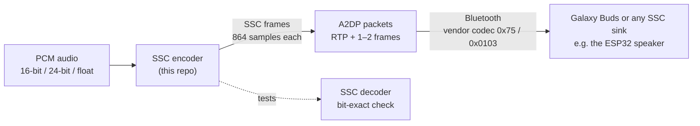

<div align="center">

# Samsung Scalable Codec (SSC) & Samsung Seamless Codec Encoder in C

**An open-source encoder for Samsung Scalable Codec / Samsung Seamless Codec, the Bluetooth codec behind Galaxy
Buds. Every mode, every bitrate, frame-for-frame compatible with Samsung's own encoder.**

[](LICENSE)


[Quick start](#quick-start) · [API](#api) · [Modes & bitrates](#modes-and-bitrates) · [Results](#results) ·
[Design](docs/design.md) · [FAQ](#faq) · [Decoder & ESP32 speaker](https://github.com/WillyBilly06/samsung-ssc-decoder)

</div>

---

## Highlights

| | |
|---|---|
| **Every SSC mode** | SSC 44.1 / 48 kHz 16-bit, **Seamless HiFi** 48 kHz 24-bit, **UHQ** 96 kHz 24-bit, all 14 bitrates (88 – 886 kbps) |
| **Samsung-compatible frames** | Frame sizes, 4-byte headers and end bands identical to Samsung's encoder on every reference frame |
| **Bitstream-checked** | 0 mismatches over ~34,600 frames: every symbol decodes exactly as written |
| **Same quality as Samsung** | Within ~0.1 dB SNR of Samsung's encoder on music, up to 3.4 dB better on pure tones |
| **Fast and portable** | Plain C99, only libm; ~170× real time at 44.1 kHz / 192 kbps on a desktop core; no global state |
| **Flexible input** | int16, 24-bit in int32, or float; the bitrate can change on every frame |

## How it fits together



SSC is built on **CELT**, the music half of Opus 1.1. This encoder adapts the BSD-licensed Opus 1.1 CELT encoder
to Samsung's bitstream: an 864-sample frame, a separate 96 kHz mode, Samsung's allocation tables, frame header and
bitrates up to 886 kbps. The companion
[samsung-ssc-decoder](https://github.com/WillyBilly06/samsung-ssc-decoder) has the decoder, ESP32 speaker
firmware and the full bitstream description.

> SSC is a classic Bluetooth A2DP (BR/EDR) vendor codec. It is not Bluetooth LE Audio or LC3.

## Modes and bitrates

| Mode | What Samsung calls it | Audio | A2DP flags | Bitrates the phone uses | Frames per packet |
|---|---|---|---|---|---|
| SSC | Samsung Scalable Codec | 44.1 / 48 kHz · 16-bit | `0x20` / `0x10` (+`0x08`) | 88, 128, 192 kbps | 1 |
| Seamless HiFi | Samsung Seamless Codec (HiFi) | 48 kHz · 24-bit | `0x04` (+`0x08`) | 88, 128, 192 kbps | 1 |
| UHQ v2 | Samsung Seamless Codec (UHQ) | 96 kHz · 24-bit | `0x02` (+`0x08`) | 152, 291, 584 kbps | 1 or 2 |
| UHQ (legacy) | – | 96 kHz · 24-bit | `0x80` | 328 kbps | 2 |

The encoder writes every one of the 14 bitrate codes in any mode. Frame size in bytes, including the 4-byte header:

| Bitrate (code) | 88k (`F0`) | 96k (`F1`) | 128k (`F2`) | 192k (`F3`) | 229k (`F4`) | 256k (`F6`) | 328k (`F5`) |
|---|---:|---:|---:|---:|---:|---:|---:|
| 44.1 / 48 kHz | 224 | 244 | 324 | 484 | 576 | 630 | 806 |
| 96 kHz | 104 | 114 | 150 | 224 | 266 | 292 | 372 |

| Bitrate (code) | 152k (`E6`) | 250k (`E5`) | 291k (`E0`) | 308k (`E1`) | 442k (`E2`) | 584k (`E3`) | 886k (`E4`) |
|---|---:|---:|---:|---:|---:|---:|---:|
| 44.1 / 48 kHz | 376 | 616 | 716 | 758 | 1086 | 1434 | 2172 |
| 96 kHz | 174 | 284 | 330 | 350 | 500 | 660 | 1000 |

44.1 and 48 kHz share one codec mode; the sample rate is not in the frame, so a sink takes it from the A2DP
configuration. Formula: `base = bitrate × 864 / (Fs × 8)` (Fs = 44100 or 96000), `+ base × 3 >> 7` for the
non-"hq" rates (`F0`–`F4`), `base |= 1`; frame = `base + 3` bytes.

## Quick start

### Build

```bash
cmake -B build
cmake --build build --config Release
```

This builds the `ssc_encoder` library, `ssc_enc_tool`, `ssc_roundtrip` and the `ssc_conformance` test. Without
CMake:

```bash
gcc -std=c99 -O2 -Iinclude src/*.c examples/ssc_enc_tool.c -o ssc_enc_tool -lm
```

### Encode a file

```bash
ssc_enc_tool -r 44100 -b 192000 input.s16le out.ssc           # SSC: 16-bit stereo PCM
ssc_enc_tool -r 48000 -b 192000 -f s24 input.s24le out.ssc     # HiFi: packed 24-bit
ssc_enc_tool -r 96000 -b 584000 -f s32 input.s32le out.ssc     # UHQ: 24-bit in 32-bit containers
```

`out.ssc` is a sequence of `[u16 little-endian length][SSC frame]`, the same format the decoder's tools read.
To hear the result, decode it with
[samsung-ssc-decoder](https://github.com/WillyBilly06/samsung-ssc-decoder) or run
`ssc_roundtrip input.s16le 192000 44100 decoded.s16le`, which encodes, decodes and prints the SNR.

### Run the tests

```bash
python3 tests/run_tests.py
```

It encodes the test signals in `tests/vectors/` at every configuration, decodes them, and compares bit
positions, frame sizes, headers and SNR with Samsung's own frames. Details: [docs/results.md](docs/results.md).

## API

```c
#include "ssc_encoder.h"

ssc_encoder *enc = ssc_encoder_create(44100);                 // 44100, 48000 or 96000
int16_t pcm[2 * SSC_ENC_FRAME_SAMPLES];                       // 864 interleaved stereo samples
uint8_t frame[SSC_ENC_MAX_FRAME_BYTES];

int len = ssc_encode(enc, pcm, 192000, 0, frame, sizeof frame);   // bytes written, < 0 on error

// HiFi / UHQ: 24-bit samples in int32 (full scale ±2^23)
int32_t pcm24[2 * SSC_ENC_FRAME_SAMPLES];
len = ssc_encode_s32(enc, pcm24, 24, 584000, 0, frame, sizeof frame);

ssc_encoder_destroy(enc);
```

| Function | Purpose |
|---|---|
| `ssc_encoder_create(rate)` / `_with_allocator(...)` | Create an encoder, optionally with your own allocator; no allocation after this |
| `ssc_encode()` / `ssc_encode_s32()` / `ssc_encode_float()` | Encode one 864-sample stereo frame from int16, 24-bit-in-int32, or float in [-1, 1) |
| `ssc_encoder_frame_bytes(rate, bitrate)` | Frame size for a rate and bitrate |
| `ssc_encoder_bitrate(bitrate_or_code)` | Convert a header rate code (`0xF3`, `0xE3`, …) to bits per second |
| `ssc_encoder_last_frame_info()` | Sequence number, end band, transient/post-filter use and bit position of the last frame |
| `ssc_encoder_reset()` | Clear history and restart the frame sequence counter |

* **Bitrate:** pass bits per second or a header rate code. It may change on any frame, as the phone does when the
  radio link gets busy.
* **Flags:** `SSC_ENC_FLAG_NO_POSTFILTER`, `SSC_ENC_FLAG_NO_TRANSIENTS`, `SSC_ENC_FLAG_FLAT_RESPONSE` (turns off
  Samsung's gentle high-frequency shaping, on by default) and `SSC_ENC_FLAG_SAMSUNG_HQ16_LEVEL` (reproduces a
  Samsung quirk with 16-bit input at hq rates; only useful for comparisons).
* **Delay:** decoded audio lags the input by 108 samples (the MDCT overlap).

## Results

SNR of encode → decode against the input, this encoder vs Samsung's frames through the same decoder (dB):

| Configuration | This encoder | Samsung |
|---|---:|---:|
| SSC 44.1 kHz, 16-bit, 88 / 192 / 229 kbps | 13.82 / 16.98 / 17.75 | 13.88 / 17.04 / 17.74 |
| 44.1 kHz, 24-bit, 328 / 584 kbps | 18.31 / 26.68 | 18.33 / 26.63 |
| Seamless HiFi 48 kHz, 24-bit, 192 kbps | 18.31 | 18.32 |
| UHQ 96 kHz, 24-bit, 291 / 584 kbps | 12.51 / 30.09 | 12.51 / 30.00 |
| Pure tones, 88 / 192 / 886 kbps | 32.96 / 41.84 / 51.98 | 33.17 / 41.41 / 48.60 |

| Check | Result |
|---|---|
| Bit positions, 47 configurations of real test signals | 0 mismatches |
| Frame sizes and headers vs Samsung, every reference frame | identical |
| Stress test: 90 runs, 26,100 frames (silence, clipping, clicks, per-frame bitrate switching) | 0 mismatches |
| Speed (desktop x86 core) | ~170× real time at 44.1 kHz / 192 kbps, ~125× at 96 kHz / 584 kbps |

The full 47-row table and how each number is measured are in [docs/results.md](docs/results.md). SNR is a plain
waveform SNR over the whole band, useful for comparing the two encoders, not as an absolute quality score.

## Repository layout

```
include/ssc_encoder.h      public API
src/                       the encoder library (C99)
  ssc_encoder.c            frame header, rate table, per-frame flow
  ssc_enc_ec.c             range coder, Laplace coder
  ssc_enc_mdct.c           forward MDCT
  ssc_enc_pitch.c          pitch search and pre-filter
  ssc_enc_analysis.c       transient, TF, spreading, dynamic allocation, trim, stereo decisions
  ssc_enc_energy.c         coarse / fine / final energy
  ssc_enc_alloc.c          bit allocation
  ssc_enc_bands.c          PVQ band coding, stereo, band splitting
  ssc_enc_tables.c         mode tables
examples/                  ssc_enc_tool (PCM -> .ssc), ssc_roundtrip (encode + decode + SNR)
tests/                     conformance test, run_tests.py, decoder copy, test vectors
docs/                      encoder design, full test results
```

## FAQ

<details>
<summary><b>Will Galaxy Buds play audio from this encoder?</b></summary>

The frames have the same sizes, headers and bitstream as Samsung's, and a decoder that parses Samsung's own frames
bit-exactly decodes them cleanly. Playback on real Galaxy Buds has **not been tested yet**: a phone is the only
SSC source today, and sending to Buds needs your own A2DP source stack that registers the SSC codec.
</details>

<details>
<summary><b>Is SSC just Opus?</b></summary>

It is based on CELT from Opus 1.1, but the bitstream is Samsung's own: frame size, band layout, allocation tables,
header and bitrate range all differ, so Opus tools cannot read or write it. See the
[comparison](https://github.com/WillyBilly06/samsung-ssc-decoder/blob/main/docs/bitstream.md#differences-from-opus-celt-11).
</details>

<details>
<summary><b>What is "Samsung Seamless Codec"?</b></summary>

The same codec (vendor `0x75`, codec `0x0103`) in its 24-bit modes: HiFi at 48 kHz and UHQ at 96 kHz.
</details>

<details>
<summary><b>Does this contain Samsung code?</b></summary>

No. It is a reimplementation for interoperability, built from the BSD-licensed Opus 1.1 CELT encoder plus the SSC
rules worked out by studying Samsung's encoder and comparing output. The codec's tables (band layout, allocation
vectors, pulse cache, caps) are format parameters, needed for a compatible bitstream.
</details>

<details>
<summary><b>How is it designed?</b></summary>

Pitch pre-filter, transient detection with short blocks, two-pass coarse energy, TF and spreading decisions,
dynamic allocation, dual stereo and PVQ, adapted from CELT 1.1 with the SSC-specific rules. The details are in
[docs/design.md](docs/design.md).
</details>

## License

[BSD-3-Clause](LICENSE). Parts adapted from Opus 1.1 keep the Xiph.Org / Opus copyright notice, reproduced in
LICENSE.

<sub>Samsung, Galaxy and Galaxy Buds are trademarks of Samsung Electronics Co., Ltd. This project is independent and
is not affiliated with or endorsed by Samsung.</sub>

<sub>**Keywords:** Samsung Scalable Codec, Samsung Seamless Codec, SSC codec, SSC encoder, Galaxy Buds codec,
Samsung UHQ, 24-bit Bluetooth audio, A2DP vendor codec, Bluetooth audio encoder, CELT, Opus.</sub>
